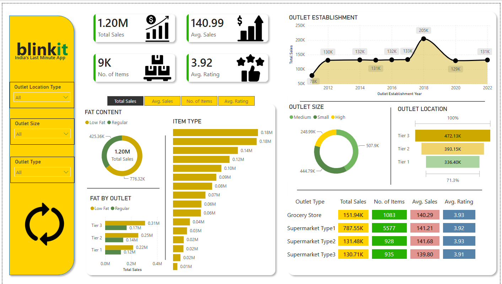

# Blinkit Grocery Sales Analysis — Power BI Dashboard

An interactive one-page Power BI dashboard that analyses sales, product mix and customer ratings for **Blinkit**, an Indian quick-commerce grocery business. It answers a simple question for a busy manager: *which outlets, products and store formats are driving revenue, and how happy are customers?*




---

## Headline numbers

| KPI | Value |
|---|---|
| Total Sales | **1.20M** |
| Average Sales per item | **141** |
| Number of items sold | **8,523** |
| Average customer rating | **3.97 / 5** |

## Key insights

- **Low Fat products bring in 64.6% of sales**, almost twice the Regular range.
- **Tier 3 locations lead on revenue (39.3%)**, ahead of Tier 2 (32.7%) and Tier 1 (28.0%). Smaller cities matter.
- **Supermarket Type 1 outlets generate 65.5% of all sales**, yet average sales per item are almost identical across every outlet type (≈140). The difference comes from volume, not basket value.
- **Fruits & Vegetables and Snack Foods are the top two categories**, each at around 175–178K in sales.
- **Medium-sized outlets contribute the most (42.3%)**, while High-size outlets contribute only 20.7%.
- **Outlets opened in 2018 are the strongest cohort**, with about 205K in sales, roughly 50% more than any other year.
- Ratings sit at 3.95–3.99 in every outlet type, so customer satisfaction is consistent rather than a differentiator.

## Dashboard features

- **KPI cards** for Total Sales, Average Sales, Number of Items and Average Rating
- **Metric switcher (field parameter)** so every chart can flip between Total Sales, Average Sales, No. of Items and Average Rating with one click
- **Sales by Fat Content** (donut) and **Fat Content by Outlet Location Tier** (clustered bar)
- **Sales by Item Type** (bar) for category performance
- **Outlet Establishment trend** (line chart by year)
- **Sales by Outlet Size** (donut) and **Sales by Location Tier** (funnel)
- **Outlet Type matrix** comparing Total Sales, Average Sales, Items and Rating side by side
- **Slicers** for Outlet Location Type, Outlet Size and Outlet Type, plus a one-click **Reset button** that clears all slicers
- Custom background, icons and a gold/green colour theme. A **white-background version** is included as well

## What I did

1. **Data cleaning (Power Query):** standardised inconsistent *Item Fat Content* labels (`LF`, `low fat` → `Low Fat`; `reg` → `Regular`) and checked data types, keeping *Rating* as a decimal so averages are not rounded.
2. **Data modelling:** built a dedicated *Key Measures* table to keep DAX measures separate from the data.
3. **DAX measures:** Total Sales, Average Sales, No. of Items and Average Rating, plus a **field parameter** (`Metrics`) to drive the dynamic visuals.
4. **Report design:** laid out a single 1400×800 page with a custom background, KPI icons and consistent formatting, then created a light theme variant.
5. **Interactivity:** synced slicers, cross-filtering and a one-click reset.

## Dataset

[`data/BlinkIT-Grocery-Data.xlsx`](data/BlinkIT-Grocery-Data.xlsx): 8,523 rows × 12 columns covering 10 outlets, 16 item types and outlets established from 2011 to 2022.

| Column | Description |
|---|---|
| Item Identifier / Item Type / Item Fat Content | Product details |
| Item Weight / Item Visibility | Product attributes |
| Outlet Identifier / Outlet Type / Outlet Size / Outlet Location Type | Store details |
| Outlet Establishment Year | Year the outlet opened |
| Sales | Sales value for the item |
| Rating | Customer rating (1–5) |

This is a public practice dataset used for training. It contains no personal data.

## Repository structure

```
├── report/
│   ├── Blinkit-Analysis.pbix         # Main dashboard (custom dark background)
│   └── Blinkit-Analysis-White.pbix   # White background version
├── data/
│   └── BlinkIT-Grocery-Data.xlsx     # Source data
├── assets/                           # Background and KPI icons used in the report
└── images/                           # Dashboard screenshots
```

## How to open

1. Install [Power BI Desktop](https://www.microsoft.com/power-platform/products/power-bi/desktop) (free).
2. Download `report/Blinkit-Analysis.pbix` and open it.
3. If you are asked for the data source, point it to `data/BlinkIT-Grocery-Data.xlsx` and refresh.

---

Built by **Bukhtawar Ali** as part of the *AI-Powered Analytics with Power BI* course (EduHubSpot), 2026.
[LinkedIn](https://www.linkedin.com/in/bukhtawar-ali-4441291a9) · [Portfolio](https://bukhtawarali110.github.io) · [GitHub](https://github.com/BukhtawarAli110)

## Licence

MIT, see [LICENSE](LICENSE). The report, DAX and documentation are mine; the dataset belongs to its original publisher.
